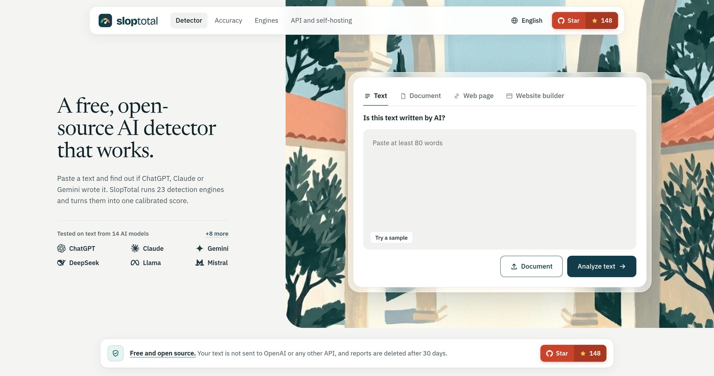
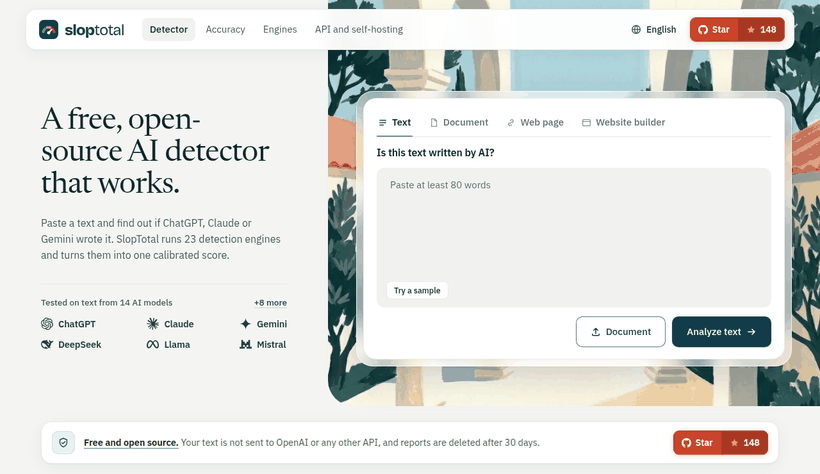
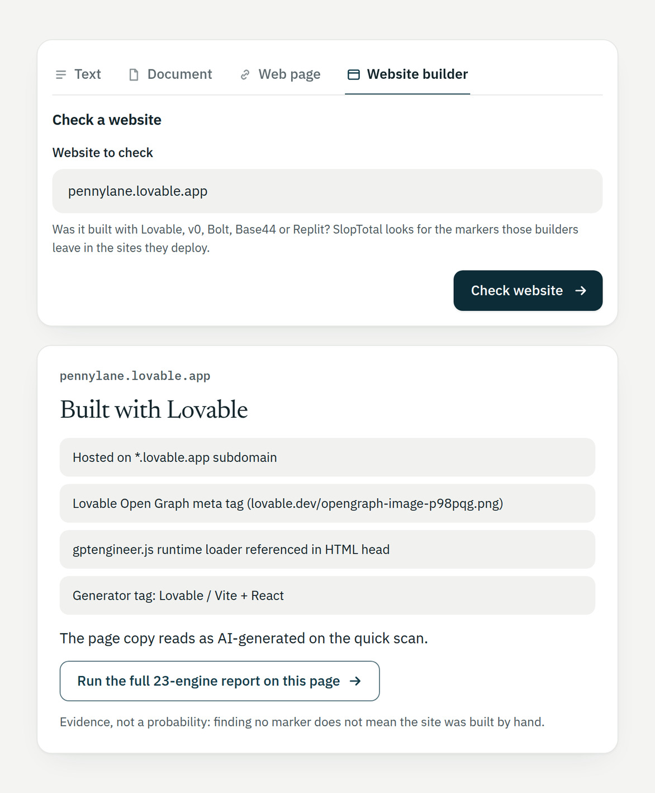

<p align="center">
  <a href="https://sloptotal.com"></a>
</p>

<p align="center">
  <a href="https://github.com/pablocaeg/sloptotal/actions/workflows/ci.yml?query=branch%3Amaster"></a>
  <a href="https://github.com/pablocaeg/sloptotal/releases"></a>
  <a href="https://github.com/pablocaeg/sloptotal/pkgs/container/sloptotal"></a>
  
  <a href="https://github.com/pablocaeg/sloptotal/stargazers"></a>
  <a href="LICENSE"></a>
  <a href="https://sloptotal.com"></a>
</p>

<p align="center"><a href="README.md">English</a> · <a href="README.zh-CN.md">简体中文</a> · <a href="README.ru.md">Русский</a> · <a href="README.es.md">Español</a> · <b>Português</b></p>

# SlopTotal

**O VirusTotal dos textos escritos por IA.** Cole um texto, envie um PDF ou um arquivo do Word, ou passe um link. Vinte e três detectores de IA independentes (classificadores neurais, testes estatísticos e heurísticas linguísticas) pontuam o conteúdo em paralelo, e um conjunto calibrado combina os votos em um único veredito que você pode detalhar mecanismo por mecanismo. Tudo roda na sua CPU, então o texto que você analisa nunca sai da sua máquina.

É uma alternativa gratuita, de código aberto e auto-hospedada a detectores online como GPTZero, Originality.ai, Copyleaks ou ZeroGPT. Em vez de um único número de um único modelo, você vê a opinião de cada modelo, e o projeto publica a própria precisão, falhas incluídas.

<p align="center">
  
</p>

**Experimente:** [sloptotal.com](https://sloptotal.com) · **Rode você mesmo:** `docker run -p 8000:8000 ghcr.io/pablocaeg/sloptotal`

> Esta é a versão em português do [README em inglês](README.md). Se houver diferença entre as duas, vale a versão em inglês.

## Recursos

- **23 mecanismos de detecção, uma pontuação calibrada.** Classificadores DeBERTa e RoBERTa, Binoculars, Fast-DetectGPT, GLTR, testes de perplexidade e de *burstiness* (variação de ritmo) e busca por frases feitas. Os resultados aparecem conforme cada mecanismo termina.
- **Texto, links e documentos.** Cole um texto, analise uma página da web (o texto principal é extraído automaticamente) ou envie um `.pdf`, `.docx`, `.txt` ou `.md`.
- **Verificação de sites: foi feito por IA?** Encontra as marcas que Lovable, v0, Bolt, Base44, Replit, Same e Emergent deixam nos sites que publicam, e mostra a evidência de cada uma. [Como funciona](#verificação-de-sites-foi-feito-por-um-construtor-de-ia)
- **Mapa de calor por parágrafo** pela API: mostra quais trechos do texto parecem de IA.
- **Medido, não prometido.** Cada número de precisão abaixo tem seu corpus, o código usado para medir e as pontuações de cada amostra.
- **Privado por padrão.** Auto-hospedado, sem APIs de IA de terceiros, sem rastreamento; os relatórios são apagados em 30 dias.
- **Uma CPU basta.** O hardware é detectado automaticamente e a GPU é opcional.
- **API JSON e [extensão para o Chrome](https://github.com/pablocaeg/sloptotal-extension)**, que marca resultados com cara de IA na busca do Google e no LinkedIn.

## Precisão medida

A maioria dos detectores publica um percentual de precisão sem dizer sobre o que foi medido. O SlopTotal é medido com o [SlopBench](tests/eval/slopbench/): 1626 textos escritos por pessoas (todos anteriores ao ChatGPT) e 1626 textos de IA sobre os mesmos temas e com o mesmo tamanho, gerados por 14 modelos atuais, em 15 gêneros (notícias, Wikipédia, arXiv, Stack Exchange, Reddit, resenhas, redações escolares e universitárias, inglês de falantes não nativos, ficção e literatura publicada entre 1532 e 1915). Cada número abaixo foi medido em gêneros com os quais o modelo não foi ajustado.

| | |
|---|---|
| AUC | **0,942** |
| Textos de IA com veredito «Provavelmente IA» (55+) | 67 % |
| Textos humanos com veredito «Provavelmente IA» (55+) | **1,7 %** |
| Textos humanos marcados de alguma forma (45+) | 3,9 % |
| Literatura de 1532 a 1915 marcada como IA | **0 de 87** |

As faixas de pontuação são ancoradas em textos humanos. A partir de 45 pontos começam os 5 % de textos humanos mais «suspeitos», a partir de 55 os 2 % e a partir de 80 os 0,5 %. Ou seja, «Provavelmente IA» significa que menos de 2 em cada 100 textos humanos recebem essa pontuação.

**O português é suportado.** A calibração multilíngue foi verificada separadamente para o português, que faz parte do grupo «supported» (AUC de pelo menos 0,90 e pelo menos 60 % dos textos de IA detectados no limite de 45), junto com o espanhol, o francês, o alemão, o italiano, o holandês, o polonês, o russo e o japonês. O árabe e o coreano ainda são experimentais; o hindi, o turco e o chinês ainda não são confiáveis, e o relatório avisa isso claramente.

**O que não funciona.** Redações em inglês de falantes não nativos ainda são marcadas com mais frequência (15 % das redações do TOEFL recebem «Provavelmente IA», contra nenhuma de 88 redações de estudantes americanos). Abaixo de cerca de 80 palavras, a pontuação é um sinal fraco. Texto de IA passado por um «humanizador» é detectado mais ou menos metade das vezes. Esses mecanismos não analisam código-fonte. Todos os resultados por fonte, modelo e mecanismo estão nos [achados](tests/eval/slopbench/FINDINGS.md), incluindo o fato de que os classificadores que lideram o benchmark RAID caem para uma AUC de 0,75 nos modelos atuais.

## Início rápido

### Docker (o mais rápido)

```bash
docker run -p 8000:8000 -v sloptotal-models:/app/models ghcr.io/pablocaeg/sloptotal
```

Abra <http://localhost:8000>. A primeira análise baixa os modelos (cerca de 9 GB, veja [docs/MODELS.md](docs/MODELS.md)) para o volume `sloptotal-models`, então as próximas inicializações são rápidas.

### A partir do código-fonte

Você precisa do **Python 3.10+**.

```bash
git clone https://github.com/pablocaeg/sloptotal.git
cd sloptotal
python3.11 -m venv venv && source venv/bin/activate
pip install -r requirements.txt
./scripts/start.sh    # ou: uvicorn app.main:app --port 8000
```

Para conferir se cada mecanismo carrega e devolve uma pontuação:

```bash
python scripts/smoke_test.py          # por padrão, http://localhost:8000
```

## Verificação de sites: foi feito por um construtor de IA?

<p align="center">
  
</p>

Os serviços do tipo «este site foi feito com vibe coding?» pontuam sobretudo o estilo (quantas classes de Tailwind há, se faltam cabeçalhos de segurança, palavras da moda) e transformam isso em um percentual. Mas sites escritos à mão também têm tudo isso. O SlopTotal procura apenas as marcas que os próprios construtores deixam no que publicam, e cada uma foi verificada em sites reais ou nos modelos do próprio construtor:

| Construtor | Marcas |
|---|---|
| Lovable | runtime `gptengineer.js`, recursos em `/lovable-uploads/`, insígnia da Lovable, `/~flock.js`, `*.lovable.app` |
| v0 (Vercel) | `<meta name="generator" content="v0.app">` do modelo da v0, `*.vusercontent.net` |
| Bolt | cabeçalho `X-Powered-By: Bolt.new`, `bolt.new/badge.js`, `*.bolt.host` |
| Base44 | chamadas à plataforma `app.base44.com`, `base44_access_token`, `*.base44.app` |
| Replit | banner de desenvolvimento do Replit Agent, insígnia do Replit, `*.replit.app` |
| Same | recursos servidos de `same-assets.com` |
| Emergent | cookies `__emg_sid` e `__emg_vid`, script `emergent-main.js`, `*.emergent.host` |

Um site sem marcas também pode ter sido escrito com ajuda de IA: o código exportado dessas ferramentas e hospedado em outro lugar, ou escrito em um editor com IA, não deixa rastros. Por isso o resultado é uma evidência e não uma probabilidade. Os textos da página são pontuados à parte pelos mecanismos de texto.

```bash
curl -X POST http://localhost:8000/api/scan/site \
  -H "Content-Type: application/json" -d '{"url": "example.com"}'
```

## API

```bash
curl -X POST http://localhost:8000/api/analyze \
  -H "Content-Type: application/json" \
  -d '{"text": "Texto que você quer analisar..."}'
```

A resposta traz cada mecanismo com sua pontuação, seu veredito e uma explicação em linguagem simples, além de `overall_score` (0-100) e `overall_verdict`. Também há pontuação rápida, pontuação por parágrafo, análise em lote e extração de texto de documentos: a lista completa está na [seção de API do README em inglês](README.md#api). Em [`examples/`](examples/) há clientes em Python e Node.js.

O serviço público do sloptotal.com foi pensado para a web e para a extensão. Se você precisa de muitas requisições, publique a sua própria instância: ela é aberta, gratuita e sem limites.

## Mecanismos de detecção

23 mecanismos em três grupos:

- **Classificadores neurais (9):** Desklib DeBERTa, SuperAnnotate, E5-Small, TMR, BERT-tiny RAID, ReMoDetect, ChatGPT Detector, Fakespot, OpenAI Detector.
- **Métodos estatísticos (7):** Log-Rank, GLTR, perplexidade, perplexidade cruzada, Fast-DetectGPT, Binoculars, DivEye.
- **Heurísticas linguísticas (7):** análise estrutural, marcadores linguísticos (as palavras favoritas da IA, como «delve» ou «tapestry»), frases feitas, riqueza de vocabulário, uniformidade da legibilidade, *burstiness* e linguagem evasiva ou atenuada.

O modelo, a AUC e a descrição de cada mecanismo estão na [tabela do README em inglês](README.md#detection-engines), e cada mecanismo tem a própria página no sloptotal.com com as pontuações medidas. Sozinhas, as heurísticas são fracas. Elas ficam porque erram *de forma independente* dos classificadores neurais, e por isso servem como voto de desempate, não como prova.

## Como a pontuação é calculada

A pontuação final vem de um modelo logístico treinado no SlopBench sobre as pontuações dos mecanismos. Os parâmetros estão em [app/calibration.json](app/calibration.json), e o que cada campo significa e como recalculá-los está explicado em [docs/CALIBRATION.md](docs/CALIBRATION.md).

1. **Pesos aprendidos, não definidos à mão.** A pontuação de cada mecanismo é convertida em log-odds e multiplicada por um peso não negativo. Um mecanismo só recebe peso pelo que acrescenta além dos outros, então mecanismos que erram juntos não contam em dobro.
2. **Faixas definidas com textos humanos.** 45, 55 e 80 pontos marcam o início dos 5 %, 2 % e 0,5 % superiores dos textos humanos.
3. **Textos curtos são puxados para a pontuação neutra**, porque trazem menos evidência. Para outros idiomas, incluindo o português, usa-se uma correção treinada separadamente.
4. **A confiança depende da pontuação.** É baixa com menos de 80 palavras, em um idioma pouco confiável ou com pontuação entre 35 e 65.

## Perguntas frequentes

**Dá para confiar em detectores de IA?** Não às cegas. Nenhum detector, este inclusive, deveria ser a única prova para acusar alguém. Por isso o SlopTotal mostra os 23 votos, o quanto eles concordam e a taxa de falsos positivos medida. Textos curtos (menos de cerca de 80 palavras) e texto de IA muito editado não são confiáveis em nenhum detector.

**Ele detecta ChatGPT, Claude, DeepSeek, Qwen ou Llama?** Os textos de IA do SlopBench vêm de 14 modelos atuais, entre eles GPT, Claude, DeepSeek, Qwen, Kimi, GLM, Gemma, Llama, Mistral e Grok. Modelos novos são cobertos na medida em que compartilham traços com esses; com as [ferramentas de avaliação](tests/eval/) você pode medir o modelo que quiser.

**Ele marca literatura clássica ou estilo formal?** Nos nossos testes, não: nenhum dos 87 textos literários de 1532 a 1915 foi marcado.

**Meu texto é guardado ou compartilhado com alguém?** Ele só é processado no servidor que você mesmo roda. Os relatórios ficam guardados por 30 dias (configurável) para que os links funcionem, e nada é enviado a serviços externos.

**Ele detecta código escrito por IA?** Não, e não afirmamos isso. A verificação de sites responde a outra pergunta: com qual construtor de IA um site foi feito.

## Contribuindo

Contribuições são bem-vindas, principalmente novos mecanismos com suas medições e melhorias para o português: corpora, calibração e tradução. Comece por [CONTRIBUTING.md](.github/CONTRIBUTING.md) e [AGENTS.md](AGENTS.md).

- [Tarefas para começar](https://github.com/pablocaeg/sloptotal/issues?q=is%3Aissue+is%3Aopen+label%3A%22good+first+issue%22): cada uma indica quais arquivos mudar
- [Reportar um erro](https://github.com/pablocaeg/sloptotal/issues/new?template=bug_report.yml)
- [Sugerir um recurso](https://github.com/pablocaeg/sloptotal/issues/new?template=feature_request.yml)
- [Sugerir um mecanismo novo](https://github.com/pablocaeg/sloptotal/issues/new?template=new_engine.yml)
- [Fazer uma pergunta ou compartilhar resultados](https://github.com/pablocaeg/sloptotal/discussions)

Se o SlopTotal for útil para você, uma ⭐ estrela no GitHub ajuda outras pessoas a encontrá-lo.

## Licença

[MIT](LICENSE)
