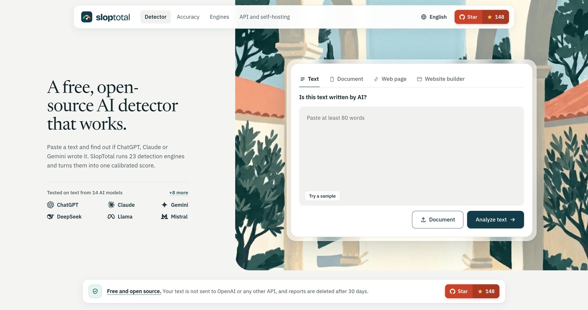
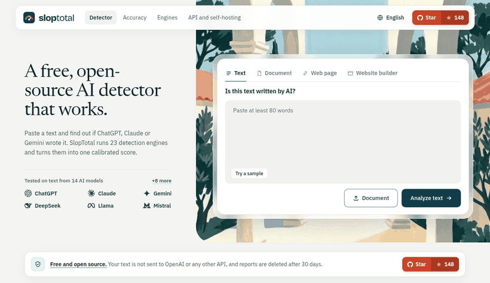
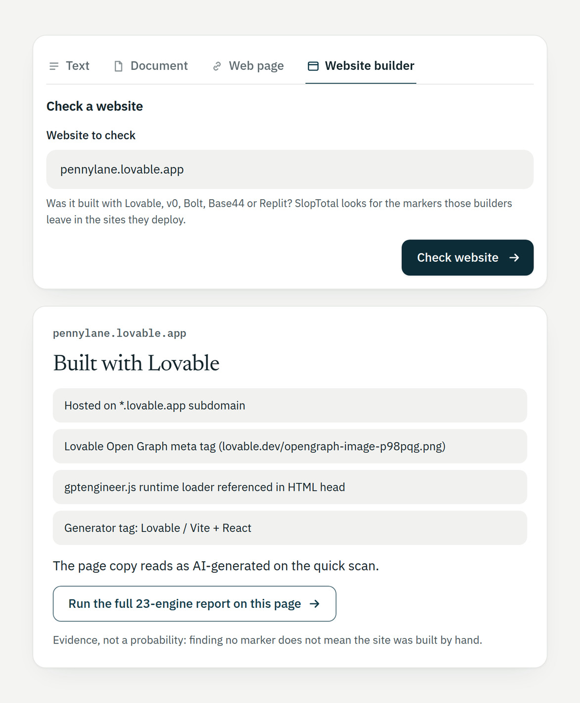

<p align="center">
  <a href="https://sloptotal.com"></a>
</p>

<p align="center">
  <a href="https://github.com/pablocaeg/sloptotal/actions/workflows/ci.yml?query=branch%3Amaster"></a>
  <a href="https://github.com/pablocaeg/sloptotal/releases"></a>
  <a href="https://github.com/pablocaeg/sloptotal/pkgs/container/sloptotal"></a>
  
  <a href="https://github.com/pablocaeg/sloptotal/stargazers"></a>
  <a href="LICENSE"></a>
  <a href="https://sloptotal.com"></a>
</p>

<p align="center"><a href="README.md">English</a> · <a href="README.zh-CN.md">简体中文</a> · <a href="README.ru.md">Русский</a> · <a href="README.es.md">Español</a> · <b>Türkçe</b></p>

# SlopTotal

**Yapay zeka tarafından üretilen metinler için VirusTotal.** Metni yapıştırın, bir PDF veya Word dosyası bırakın ya da bir URL verin. Yirmi üç bağımsız yapay zeka algılayıcısı (sinir ağı sınıflandırıcıları, istatistiksel testler ve dilbilimsel buluşsal yöntemler) metni paralel olarak puanlar ve kalibre edilmiş bir topluluk (ensemble) modeli, oylarını motor motor inceleyebileceğiniz tek bir karara dönüştürür. Kendi CPU'nuzda çalışır, bu nedenle taradığınız hiçbir şey makinenizden dışarı çıkmaz.

GPTZero, Originality.ai, Copyleaks, ZeroGPT ve Humalingo gibi barındırılan yapay zeka içerik algılayıcılarına ücretsiz, kendi sunucunuzda barındırabileceğiniz (self-hosted), açık kaynaklı bir alternatiftir. Tek bir modelden gelen tek bir sayı yerine size her modelin görüşünü gösterir ve başarısızlıklar dahil ne kadar doğru olduğunu yayınlar.

<p align="center">
  
</p>

**Deneyin:** [sloptotal.com](https://sloptotal.com) · **Yerel olarak çalıştırın:** [tek Docker komutu](#yerel-olarak-çalıştırın)

<a name="quick-start"></a>

## Yerel olarak çalıştırın

x86-64 makinede Docker, tek komut:

```bash
docker run -d --name sloptotal -p 8000:8000 -v sloptotal-models:/app/models ghcr.io/pablocaeg/sloptotal
```

İlk başlatma, `sloptotal-models` birimine yaklaşık 9 GB model indirir; böylece sonraki başlatmalar hızlı olur. Günlüklerde modellere yüklendiği yazana kadar bekleyin, ardından <http://localhost:8000> adresini açın:

```bash
until docker logs sloptotal 2>&1 | grep -q "Model preloading complete"; do sleep 10; done
```

Çalıştığını doğrulayın:

```bash
curl -s -X POST http://localhost:8000/api/analyze \
  -H "Content-Type: application/json" \
  -d '{"text": "Artificial intelligence has fundamentally transformed the landscape of modern education, offering unprecedented opportunities for personalized learning. Moreover, it is important to note that these tools foster critical thinking and collaboration among students."}'
```

Bir JSON raporu döndürür: `overall_score` (0-100), `overall_verdict` ve 23 `engine_results`. `curl -s http://localhost:8000/health` komutu `"status":"healthy"` döndürür.

**Gereksinimler.** Yaklaşık 12 GB RAM (yüklenen modeller yaklaşık 8,3 GB yer kaplar, tahmini bir değerdir; bkz. [docs/MODELS.md](docs/MODELS.md)) ve yaklaşık 9 GB disk alanı. GPU, hesap veya API anahtarı gerekmez. İmaj yalnızca `linux/amd64` için derlenmiştir: Apple Silicon veya diğer ARM makinelerde kaynaktan kurun.

**Kaynaktan kurulum** (Python 3.10 - 3.14; macOS ile gelen 3.9 çok eskidir):

```bash
git clone https://github.com/pablocaeg/sloptotal.git
cd sloptotal
python3 -m venv venv
source venv/bin/activate
pip install -r requirements.txt
./scripts/start.sh    # veya: uvicorn app.main:app --port 8000
```

`HF_HOME` ayarlanmadıkça modeller `~/.cache/huggingface` dizinine gider.
Ardından `python scripts/smoke_test.py` her rotayı ve tüm 23 motoru kontrol eder.
İmajı kendiniz derlemek için: `docker compose -f docker/docker-compose.yml up -d`.

Docker imajı yalnızca CPU'lu PyTorch kullanır; NVIDIA GPU için kaynaktan kurun ve [Yapılandırma](#yapılandırma) bölümünü izleyin. Çevrimdışı kullanım, güncellemeler ve yaygın sorunlar [kendi kendine barındırma kılavuzunda](https://sloptotal.com/self-host/) ([Markdown](https://sloptotal.com/self-host.md)) yer alır.

## Yapay zeka ajanları için

SlopTotal'ı bir kullanıcı için kurarken veya bir araç olarak çağırırken:

1. `docker --version` ve `uname -m`. `x86_64` üzerinde Docker varsa yukarıdaki Docker komutunu kullanın. Aksi halde veya Docker yoksa kaynaktan kurun.
2. Başlatın, ardından günlükte `Model preloading complete` mesajını bekleyin (yukarıdaki döngü). İlk başlatma dakikalar sürer: yaklaşık 9 GB indirir.
3. Yukarıdaki `curl` ile kontrol edin. `overall_score` ve `"engines_total": 23` içeren herhangi bir JSON çalıştığı anlamına gelir.
4. `POST /api/analyze` uç noktasını `{"text": "..."}` (50 karakter veya daha fazla) ya da `{"url": "..."}` ile çağırın. 200 rapor döndürür. 202 kuyruğa alındığı anlamına gelir: 200 dönene kadar `GET /api/queue/ticket/{ticket_id}` adresini yoklayın. 429 kuyruğun dolu olduğu anlamına gelir: `retry_after` saniye bekleyip yeniden deneyin.
5. `overall_score` değerini okuyun: 45 insan yazımının en üst %5'inin başladığı yerdir, 55 en üst %2, 80 en üst %0,5'tir. Yaklaşık 80 kelimenin altında zayıf bir sinyaldir ve hiçbir algılayıcı tek başına kanıt değildir.

Anahtar gerekmez. OpenAPI şeması `http://localhost:8000/openapi.json` adresindedir.
Python, Node, Go ve Ruby için hazır istemciler [examples/](examples/) içindedir (bkz. [API](#api)). Modeller yüklendikten sonra günlük, GitHub yıldızı isteyen tek bir satır yazdırır; `SLOPTOTAL_QUIET=1` bunu gizler. API yanıtları bunu asla içermez.

## Özellikler

- **23 algılama motoru, tek kalibre edilmiş puan.** DeBERTa ve RoBERTa sınıflandırıcıları, Binoculars, Fast-DetectGPT, GLTR, şaşkınlık (perplexity) ve patlama (burstiness) testleri ile kalıp ifade buluşsal yöntemleri. Sonuçlar her motor bitirdikçe akış halinde gelir.
- **Metin, URL'ler ve belgeler.** Metin yapıştırın, bir web sayfasını tarayın (ana içerik otomatik olarak çıkarılır) veya `.pdf`, `.docx`, `.txt` ya da `.md` yükleyin.
- **Site kontrolü: bu web sitesi vibe-coded mı?** Lovable, v0, Bolt, Base44, Replit, Same ve Emergent'in dağıttıkları sitelerde bıraktığı parmak izlerini bulur ve her biri için kanıtları gösterir. [Nasıl çalışır](#site-kontrolü-yapay-zeka-uygulama-oluşturucularıyla-yapılan-siteleri-algılama)
- **API üzerinden paragraf bazlı ısı haritası**, hangi bölümlerin yapay zeka gibi okunduğunu görmek için.
- **İddia edilmedi, ölçüldü.** Aşağıdaki her doğruluk sayısı derlem, değerlendirme düzeneği ve ham örnek bazlı puanlarla birlikte gelir.
- **Varsayılan olarak gizli.** Kendi sunucunuzda barındırılır, üçüncü taraf yapay zeka API'si yoktur, izleme yoktur, raporlar 30 gün sonra silinir.
- **Yalnızca CPU yeterlidir.** Donanımınızı otomatik algılar; GPU isteğe bağlıdır. Yüklenen modeller yaklaşık 8,3 GB RAM gerektirir (tahmini değer; bkz. [docs/MODELS.md](docs/MODELS.md)).
- Google Arama ve LinkedIn'de yapay zeka görünümlü sonuçları işaretleyen **JSON API ve [Chrome eklentisi](https://github.com/pablocaeg/sloptotal-extension)**.

## Ölçülen doğruluk

Çoğu algılayıcı, ne üzerinde ölçüldüğünü söylemeden bir doğruluk oranı yayınlar. SlopTotal [SlopBench](tests/eval/slopbench/) üzerinde ölçülmüştür: tamamı ChatGPT'den önce yazılmış 1.626 insan metni ve 15 yazı türünde (haberler, Vikipedi, arXiv, Stack Exchange, Reddit, incelemeler, öğrenci makaleleri, ana dili İngilizce olmayanlar, kurgu ve 1532-1915 yılları arasında yayınlanmış edebiyat) 14 güncel modelden aynı konularda ve aynı uzunluklarda 1.626 yapay zeka metni. Aşağıdaki her sayı, modelin üzerinde ayarlanmadığı yazı türlerinde ölçülmüştür.

| | |
|---|---|
| AUC | **0.942** |
| "Muhtemelen YZ" olarak adlandırılan YZ metinleri (55+) | 67% |
| "Muhtemelen YZ" olarak adlandırılan insan metinleri (55+) | **1.7%** |
| Herhangi bir şekilde işaretlenen insan metinleri (45+) | 3.9% |
| İşaretlenen 1532-1915 arası yayınlanmış edebiyat | **87 üzerinden 0** |

Puan bantları bu insan metinlerine göre sabitlenmiştir: 45 insan yazımının en üst %5'inin başladığı yerdir, 55 en üst %2, 80 en üst %0,5'tir. Dolayısıyla "Muhtemelen YZ", 100 insan metninden 2'sinden azının bu kadar yüksek puan aldığı anlamına gelir.

**Diğer diller.** İspanyolca, Fransızca, Almanca, İtalyanca, Portekizce, Felemenkçe, Lehçe, Rusça ve Japonca desteklenir (AUC 0.91 ile 0.997 arası); Arapça ve Korece deneyseldir; Hintçe, Türkçe ve Çince henüz güvenilir değildir ve rapor bunu belirtir.

**Ne işe yaramaz.** Ana dili İngilizce olmayan yazarların makaleleri hala ana dili İngilizce olanlardan daha fazla işaretlenmektedir (88 ABD okul makalesinin hiçbirine karşılık TOEFL makalelerinin %15'i Muhtemelen YZ olarak adlandırılmıştır). Yaklaşık 80 kelimenin altında puan zayıf bir sinyaldir. Bir "insanlaştırıcı"dan (humanizer) geçirilen yapay zeka metni yaklaşık yarı yarıya yakalanır. Kaynak kodu bu motorların kapsamı dışındadır. Kaynak, model ve motor bazında tüm veriler, RAID kıyaslamasında zirvede yer alan sınıflandırıcıların güncel modellerde AUC 0.75'e düştüğü bulgusu dahil olmak üzere [bulgularda](tests/eval/slopbench/FINDINGS.md) yer almaktadır.

## Site kontrolü: yapay zeka uygulama oluşturucularıyla yapılan siteleri algılama

<p align="center">
  
</p>

"Bu web sitesi vibe-coded mı?" kontrolcüleri çoğunlukla stili puanlar (Tailwind sınıf sayıları, eksik güvenlik başlıkları, moda kelimeler) ve bunu bir yüzdeye dönüştürür. Elle yazılmış siteler de bu özelliklerin tümünü paylaşır. SlopTotal yalnızca oluşturucuların dağıttıkları ürünlerde bıraktığı ve her biri canlı sitelerde veya oluşturucuların kendi şablonlarında doğrulanmış işaretlere bakar:

| Oluşturucu | Parmak izleri |
|---|---|
| Lovable | `gptengineer.js` çalışma zamanı, `/lovable-uploads/` varlıkları, Lovable rozeti, `/~flock.js`, `*.lovable.app` |
| v0 (Vercel) | v0'ın düzen şablonundan `<meta name="generator" content="v0.app">`, `*.vusercontent.net` |
| Bolt | `X-Powered-By: Bolt.new` başlığı, `bolt.new/badge.js`, `*.bolt.host` |
| Base44 | `app.base44.com` platform çağrıları, `base44_access_token`, `*.base44.app` |
| Replit | Replit Agent geliştirici afişi, Replit rozeti, `*.replit.app` |
| Same | `same-assets.com` üzerinden sunulan varlıklar |
| Emergent | `__emg_sid` ve `__emg_vid` çerezleri, `emergent-main.js` betiği, `*.emergent.host` |

Hiçbir işareti olmayan bir site yine de yapay zeka ile yazılmış olabilir: bu araçlardan dışa aktarılıp başka bir yerde barındırılan veya bir yapay zeka düzenleyicisinde yazılan kod parmak izi taşımaz. Bu nedenle sonuç bir olasılık değil, kanıttır. Sayfanın metin içeriği, metin motorları tarafından ayrı olarak puanlanır.

```bash
curl -X POST http://localhost:8000/api/scan/site \
  -H "Content-Type: application/json" -d '{"url": "example.com"}'
```

## API

| Uç nokta | Yöntem | Ne yapar | Tipik gecikme (CPU) |
|---|---|---|---|
| `/api/analyze` | POST | `text` veya `url` için tam 23 motorlu rapor | 2-8 s |
| `/api/quick-score` | POST | 4 sınıflandırıcı artı buluşsal yöntemler | 0.1-0.5 s |
| `/api/paragraph-score` | POST | Paragraf başına puan (ısı haritası) | 1-3 s |
| `/api/scan/site` | POST | Yapay zeka uygulama oluşturucu parmak izleri artı metin puanı | 1-3 s |
| `/api/extract` | POST | Yüklenen `.pdf` / `.docx` / `.txt` dosyasından metin (multipart `file`) | < 1 s |
| `/api/scan/snippets` | POST | 1-30 kısa parçacık toplu tarama | ~0.5 s |
| `/api/scan/urls` | POST | Sayfa türüne duyarlı 1-10 URL toplu tarama | 1-5 s |
| `/api/engines` | GET | Motor meta verileri | anlık |
| `/api/report/{id}` | GET | Kaydedilmiş bir rapor | anlık |
| `/api/report/{id}/feedback` | POST | Metni gerçekte kimin yazdığını kaydedin: `{"label": "human" \| "ai" \| "mixed" \| "unsure"}` | anlık |
| `/api/queue/status` | GET | Kuyruk kapasitesi | anlık |

```bash
curl -X POST http://localhost:8000/api/analyze \
  -H "Content-Type: application/json" \
  -d '{"text": "Analiz edilecek metniniz buraya..."}'
```

Python'dan [`examples/python_client.py`](examples/python_client.py) bir metni analiz eder, en yüksek puanı veren beş motoru yazdırır ve sunucu meşgulken kuyrukta bekleyerek bir site kontrolü çalıştırır:

```bash
python examples/python_client.py "Buraya en az 50 karakterlik metin yapıştırın..." example.com
```

Yanıt, her motoru puanı, kararı ve sade dilli bir ayrıntı satırıyla birlikte listeler; ayrıca `overall_score` (0-100) ve `overall_verdict` değerlerini içerir.

Node 18+'dan [`examples/node_client.mjs`](examples/node_client.mjs), bir metni analiz etmek ve genel puanı, kararı ve en yüksek puanı veren beş motoru yazdırmak için yerleşik `fetch` işlevini kullanır. Başka bir sunucuya yönlendirmek için `--base` parametresini geçin:

```bash
node examples/node_client.mjs "Buraya en az 50 karakterlik metin yapıştırın..." --base http://localhost:8000
```

Go'dan [`examples/go_client/main.go`](examples/go_client/main.go), bir metni analiz etmek ve genel puanı, kararı ve en yüksek puanı veren beş motoru yazdırmak için yalnızca standart kütüphaneyi kullanır:

```bash
go run examples/go_client/main.go "Buraya en az 50 karakterlik metin yapıştırın..." --base http://localhost:8000
```

## Algılama Motorları

Her motor, her iki derlem üzerinde ölçülen puanlarını içeren sloptotal.com sayfasına bağlanır. Aşağıdaki AUC, motorun rastgele bir yapay zeka pasajını rastgele bir insan pasajından daha yüksek sıralama olasılığıdır: 1.0 mükemmeldir, 0.5 yazı tura gibidir.

### Sinir Ağı Sınıflandırıcıları

| Motor | Model | AUC | Notlar |
|---|---|---|---|
| [Desklib DeBERTa](https://sloptotal.com/engines/desklib-deberta/) | DeBERTa-v3-large (435M) | 1.000 | Kendi testlerimizdeki en güçlü ayrım |
| [SuperAnnotate](https://sloptotal.com/engines/superannotate/) | RoBERTa-large (355M) | 0.989 | Eski (arkaik) düzyazıya karşı ölçülebilir önyargı yok |
| [E5-Small](https://sloptotal.com/engines/e5-small/) | E5 + LoRA (33M) | 0.999 | 33M parametre ile çok daha büyük modellerle eşleşiyor |
| [TMR Detector](https://sloptotal.com/engines/tmr-detector/) | RoBERTa-base (125M) | 1.000 | RAID ile eğitilmiş, bu yüzden RAID puanları onu abartıyor |
| [BERT-tiny RAID](https://sloptotal.com/engines/bert-tiny-raid/) | BERT-tiny (4.4M) | 1.000 | Milisaniyeler içinde yanıt verir |
| [ReMoDetect](https://sloptotal.com/engines/remodetect/) | DeBERTa (184M) | 0.941 | RLHF ile hizalanmış LLM'leri hedefler |
| [ChatGPT Detector](https://sloptotal.com/engines/chatgpt-detector/) | RoBERTa-base (125M) | 0.829 | ChatGPT'ye özgü |
| [Fakespot](https://sloptotal.com/engines/fakespot/) | RoBERTa-base (125M) | 0.999 | Modern metinlerde doğru, ancak 1920 öncesi düzyazıda +0.533 önyargı |
| [OpenAI Detector](https://sloptotal.com/engines/openai-detector/) | RoBERTa-base (125M) | 0.771 | 2019 GPT-2 algılayıcısı; modern LLM'lerde daha zayıf |

### İstatistiksel Yöntemler

| Motor | Yöntem | AUC |
|---|---|---|
| [Log-Rank](https://sloptotal.com/engines/log-rank/) | GPT-2 altında ortalama log-rank | 0.909 |
| [GLTR](https://sloptotal.com/engines/gltr/) | Token sıra dağılımı | 0.904 |
| [Perplexity](https://sloptotal.com/engines/perplexity/) | GPT-2 şaşkınlık (perplexity) puanlaması | 0.901 |
| [Cross-Perplexity](https://sloptotal.com/engines/cross-perplexity/) | İki modelli şaşkınlık karşılaştırması | 0.891 |
| [Fast-DetectGPT](https://sloptotal.com/engines/fast-detectgpt/) | Koşullu olasılık eğriliği | 0.890 |
| [Binoculars](https://sloptotal.com/engines/binoculars/) | İki dil modeli arasındaki çapraz entropi oranı | 0.836 |
| [DivEye](https://sloptotal.com/engines/diveye/) | Şaşırma (surprisal) çeşitliliği | 0.730 |

### Dilbilimsel Buluşsal Yöntemler

| Motor | Sinyal | AUC |
|---|---|---|
| [Structural Analysis](https://sloptotal.com/engines/structural-analysis/) | Uzun tire (em-dash) kullanımı, cümle tekdüzeliği | 0.836 |
| [Linguistic Markers](https://sloptotal.com/engines/linguistic-markers/) | Yapay zekanın tercih ettiği ifadeler ("delve", "tapestry"...) | 0.713 |
| [Formulaic Patterns](https://sloptotal.com/engines/formulaic-patterns/) | Klişe açılışlar ve kapanışlar | 0.698 |
| [Vocabulary Richness](https://sloptotal.com/engines/vocabulary-richness/) | Tür-token oranı (type-token ratio), hapax legomena | 0.583 |
| [Readability Uniformity](https://sloptotal.com/engines/readability-uniformity/) | Paragraflar arası tutarlılık | 0.581 |
| [Burstiness](https://sloptotal.com/engines/burstiness/) | Cümle başına şaşkınlık varyansı | 0.582 |
| [Sentiment & Hedging](https://sloptotal.com/engines/sentiment-and-hedging/) | Kaçamak ifadeler ve zoraki denge | 0.522 |

Dilbilimsel buluşsal yöntemler tek başlarına zayıftır. Sinir ağı sınıflandırıcılarından *bağımsız* olarak başarısız oldukları için tutulurlar; bu da onları kanıt olarak değil, eşitlik bozucu (tiebreaker) olarak kullanışlı kılar.

## Puanlama

Genel puan, [SlopBench](tests/eval/slopbench/) üzerine uydurulmuş (fitted) motor puanları üzerinden çalışan bir lojistik modeldir. Uydurulan parametreler [app/calibration.json](app/calibration.json) dosyasındadır ve uydurma raporundaki ([tests/eval/slopbench/FINDINGS.md](tests/eval/slopbench/FINDINGS.md)) her sayı, modelin hiç görmediği yazı türlerinde ölçülmüştür. [docs/CALIBRATION.md](docs/CALIBRATION.md) JSON içindeki her alanı ve bunun nasıl yeniden oluşturulacağını açıklar.

1. **Elle değil, uydurmadan gelen ağırlıklar.** Her motorun puanı log-odds'a dönüştürülür ve model tarafından ağırlıklar negatif olmayacak şekilde ağırlıklandırılır. Bir motor yalnızca diğerleri bilindikten sonra eklediği değer kadar ağırlık kazanır; böylece birlikte başarısız olan motorlar iki kez sayılmaz. İngilizcede 23 motordan 8'i ağırlık taşır (Structural, Desklib, Fakespot, SuperAnnotate, Formulaic, Readability, Binoculars ve Burstiness). Diğer 15'i bunların üzerine hiçbir şey eklemez ve yine de her biri raporda gösterilir.
2. **İnsan metnine göre belirlenen bantlar.** Çıktı, 45 insan metinlerinin en üst %5'inin başladığı yer, 55 en üst %2 ve 80 en üst %0,5 olacak şekilde eşlenir.
3. **Kısa metinler geri tutulur.** Kısa İngilizce metinler `words / (words + 5)` ile nötr bir puana doğru çekilir; diğer diller uydurulmuş bir kısa metin terimi kullanır. Boşluksuz yazılan alfabeler (Çince, Japonca, Tayca ve diğerleri) bunu atlar.
4. **Diğer diller.** İnsan metinlerinin %5'inin 45'in üzerinde puan alacağı şekilde yerleştirilmiş dil başına kaydırmalı (offset) ayrı bir uydurma ve bir destek durumu: Almanca, İspanyolca, Fransızca, İtalyanca, Japonca, Felemenkçe, Lehçe, Portekizce ve Rusça için desteklenir; Arapça ve Korece için deneyseldir; Hintçe, Türkçe ve Çince için henüz güvenilir değildir.
5. **Puana göre güven düzeyi.** 80 kelimenin altında, henüz güvenilir olmayan bir dilde veya 35 ile 65 arasında düşük; deneysel bir dilde veya 15 ile 80 arasında orta; aksi halde yüksektir.

v1.1'e kadar puan, dört sınıflandırıcıya sabitlenmiş elle ağırlıklandırılmış bir karışımdı. [tests/eval/FINDINGS.md](tests/eval/FINDINGS.md) bu geçmişi ve buna yol açan 1920 öncesi düzyazıya karşı Fakespot önyargısını saklar.

## Yapılandırma

SlopTotal başlangıçta CPU, RAM ve GPU'yu algılar ve bir profil seçer. Her şey ortam değişkenleriyle geçersiz kılınabilir; bkz. [`.env.example`](.env.example).

| Profil | Ne zaman seçilir (RAM) | CPU | GPU | Notlar |
|---------|-------------------|-----|-----|-------|
| Lite | 8 GB altı | 2 çekirdek | Yok | Daha az işçi (worker); yine de her modeli yükler |
| Standard | 8 GB veya daha fazla | 4 çekirdek | Yok | Çoğu dizüstü bilgisayar için varsayılan |
| Performance | 16 GB veya daha fazla | 6+ çekirdek | CUDA isteğe bağlı | Havuz kopyaları, maksimum verim |

Profiller hangi motorların çalışacağını değil, işçileri ve kopyaları değiştirir. Her profil tüm modelleri yükler: yüklendikten sonra yaklaşık 8,3 GB RAM (tahmini) ve diskte yaklaşık 9 GB. Tek bir makinede ölçülen motor başına bellek ve gecikme [docs/MODELS.md](docs/MODELS.md) içindedir.

**NVIDIA GPU:** `requirements.txt` yalnızca CPU'lu torch paketini kurar. Modelleri GPU üzerinde çalıştırmak için bunu aynı torch sürümünün CUDA derlemesiyle değiştirin (sürümü koruyun: torch'u yükseltmek puanları değiştirebilir):

```bash
pip uninstall -y torch
pip install torch==<installed version> --index-url https://download.pytorch.org/whl/cu130 --extra-index-url https://pypi.org/simple
python -c "import torch; print(torch.cuda.is_available())"   # True
```

`cu130`, CUDA 13 destekli bir NVIDIA sürücüsü gerektirir ve RTX 20xx'ten 50xx'e kadar olan kartları kapsar; eski kartlar için [pytorch.org](https://pytorch.org/get-started/locally/) adresinden başka bir dizin seçin. CUDA ve en az 4 GB VRAM ile başlangıç `performance` profilini seçer ve başlıkta `Device: cuda` gösterilir. Tüm modeller fp32'de çalışır, böylece puanlar CPU ile üç ondalık basamağa kadar eşleşir.

**Yüksek RAM'li CPU sunucuları (ör. 64 GB, GPU yok):** otomatik olarak `performance` profilini alırsınız. CUDA olmadan tüm çıkarım CPU'da kalır ancak daha fazla eşzamanlı işçi ve model havuzu kopyası çalıştırabilirsiniz:

```bash
# 64 GB yalnızca CPU sunucusu için ayar
export SLOPTOTAL_PROFILE=performance
export SLOPTOTAL_TORCH_THREADS=8
export SLOPTOTAL_FULL_WORKERS=8
export SLOPTOTAL_SNIPPET_WORKERS=6
export SLOPTOTAL_MAX_CONCURRENT_FULL=4
export SLOPTOTAL_POOL_FAKESPOT=2
export SLOPTOTAL_POOL_TMR=2
./scripts/start.sh
```

| Değişken | Varsayılan | Amaç |
|---|---|---|
| `SLOPTOTAL_PROFILE` | auto | `lite`, `standard` veya `performance` |
| `SLOPTOTAL_RETENTION_DAYS` | `30` | Raporları N gün sonra sil (`0` saklar) |
| `SLOPTOTAL_DIRECT_DAILY_LIMIT` | `0` (sınır yok) | Aşağıdaki birinci taraf kökenlerin dışından analiz başlatan istemci IP'si başına UTC günü başına çağrı sayısı; herkese açık bir örnek için |
| `SLOPTOTAL_FIRST_PARTY_ORIGINS` | sloptotal.com, eklenti, localhost | CORS tarafından izin verilen ve günlük sınır tarafından sayılmayan tarayıcı kökenleri için regex |
| `SLOPTOTAL_ALLOW_PRIVATE_URLS` | kapalı | URL taramalarının özel veya intranet ana bilgisayarlarına ulaşmasına izin ver (varsayılan olarak engelli) |
| `SLOPTOTAL_DATA_DIR` | proje kökü `data/` | Saklanan raporlar ve veritabanı için dizin |
| `SLOPTOTAL_DB_NAME` | `sloptotal.db` | Veri dizini içindeki veritabanı dosya adı |
| `SLOPTOTAL_DB_TIMEOUT` | `30.0` saniye | SQLite bağlantı zaman aşımı |
| `SLOPTOTAL_DB_BUSY_TIMEOUT` | `5000` milisaniye | SQLite meşgul zaman aşımı |
| `SLOPTOTAL_CACHE_ENABLED` | `true` | Sonuç önbelleğe almayı etkinleştir (`true`, `1` veya `yes`, büyük/küçük harf duyarsız) |
| `SLOPTOTAL_DEVICE` | otomatik algılanır | Çıkarım cihazını `cpu` veya `cuda` ile geçersiz kıl; aksi halde kullanılabilir olduğunda CUDA kullanılır |
| `SLOPTOTAL_RESERVED_CORES` | `2` | Kullanılabilir analizör çekirdeklerini hesaplarken ayrılan CPU çekirdekleri |
| `SLOPTOTAL_SHORT_LANE_WORDS` | `350` | Kısa metin şeridi için kelime sayısı eşiği |
| `SLOPTOTAL_SHORT_WORKERS` | `4` | Kısa metin işçi sayısı |
| `SLOPTOTAL_MAX_CONCURRENT_SHORT` | `2` | Kuyruk yöneticisi tarafından uygulanan eşzamanlı kısa metin tarama sınırı |
| `SLOPTOTAL_MAX_CONCURRENT_SNIPPET` | `4` (lite'ta `2`) | Eşzamanlı parçacık tarama sınırı |
| `SLOPTOTAL_POOL_BERT_RAID` | `1` (aşağıya bakın) | BERT RAID model havuzu kopyaları |
| `SLOPTOTAL_POOL_E5` | `1` (aşağıya bakın) | E5 model havuzu kopyaları |
| `SLOPTOTAL_POOL_FAKESPOT` | `1` (aşağıya bakın) | Fakespot model havuzu kopyaları |
| `SLOPTOTAL_POOL_TMR` | `1` (aşağıya bakın) | TMR model havuzu kopyaları |
| `SLOPTOTAL_QUIET` | kapalı | `1`, `true` veya `yes` başlangıç günlüğündeki tek satırlık GitHub yıldız notunu kaldırır |
| `HF_HOME` | `~/.cache/huggingface` (Docker imajı: `/app/models`) | Model ağırlıklarının önbelleğe alındığı yer |

Başlangıç profilleri, analizör yedek varsayılanlarını okumadan önce ayarlanmamış değerleri doldurur. Açık ortam değişkenleri önceliklidir. Lite profili parçacık eşzamanlılık sınırını `2` olarak ayarlar; diğer profiller `4` kullanır. CPU'da performance profili, RAM en az 32 GB olduğunda yukarıdaki dört sınıflandırıcı havuzunun tümünü `2` olarak ayarlar; aksi halde CUDA profilleri dahil bu havuzlar `1` kullanır.

## SSS

**Yapay zeka algılayıcılarına güvenilebilir mi?** Körlemesine değil. Bu algılayıcı dahil hiçbir algılayıcı bir suçlama için tek kanıt olmamalıdır. SlopTotal'ın tüm 23 oyu, ne kadar uzlaştıklarını ve ölçülen yanlış pozitif oranını göstermesinin nedeni budur. Kısa metinler (yaklaşık 80 kelimenin altı) ve yoğun şekilde düzenlenmiş yapay zeka metinleri her algılayıcı için güvenilmezdir.

**ChatGPT, Claude, Gemini, Llama ve Mistral'i algılıyor mu?** Değerlendirme derlemi GPT-4, ChatGPT, Llama ve Mistral çıktılarını içerir. Sınıflandırıcılar daha geniş bir karışım üzerinde eğitilmiştir. Daha yeni modeller bu parmak izlerini paylaştıkları ölçüde kapsanır; [değerlendirme düzeneği](tests/eval/) önemsediğiniz herhangi bir modeli ölçmenizi sağlar.

**Klasik edebiyatı veya resmi yazıları işaretler mi?** Testlerimizde hayır: Austen, Melville, Kafka, Machiavelli ve diğerlerinden alınan 26 pasajın hiçbiri işaretlenmemiştir. 1920 öncesi düzyazı, tam da saf algılayıcıların üzerinde başarısız olması nedeniyle değerlendirmenin bir parçasıdır.

**Metnim saklanıyor veya paylaşılıyor mu?** Çalıştırdığınız sunucuda işlenir. Rapor bağlantılarının çalışması için raporlar 30 gün (yapılandırılabilir) saklanır ve dış bir servise hiçbir şey gönderilmez.

**Yapay zeka tarafından üretilen kodu algılayabilir mi?** Hayır ve algılayabildiğini iddia etmiyoruz: testlerde motorlar insan kodunu hiç işaretlemedi ancak makine tarafından yazılan kodu da hiç yakalamadı. Site kontrolü, bir web sitesini hangi yapay zeka uygulama oluşturucusunun ürettiğini bildirir ki bu farklı bir sorudur.

## Sorun Giderme

| Belirti | Çözüm |
|---|---|
| Başlangıçta `TypeError: unsupported operand type(s) for \|` | Python 3.9 veya daha eski; 3.10+ kullanın |
| Bir motor `Model loading failed` bildiriyor | İlk model indirmesi için disk alanını ve ağı kontrol edin, ardından yeniden başlatın; `python scripts/smoke_test.py` hangi motorun başarısız olduğunu gösterir |
| İlk tarama yavaş | Modeller yükleniyor; sonraki taramalar saniyeler sürer |
| `no matching manifest for linux/arm64/v8` | İmaj yalnızca amd64 içindir; kaynaktan kurun veya `--platform linux/arm64` yerine `--platform linux/amd64` ekleyin (emüle edilir, çok daha yavaştır) |
| Konteyner 137 çıkış koduyla duruyor | Bellek yetersiz; Docker Desktop'ta bellek sınırını 12 GB'a yükseltin (Settings, Resources) |
| `port is already allocated` | 8000 portu dolu; `-p 8080:8000` ile çalıştırın ve <http://localhost:8080> adresini kullanın |
| URL taraması "private network address" diyor | Kasıtlı; intranet sayfalarını taramak için `SLOPTOTAL_ALLOW_PRIVATE_URLS=1` ayarlayın |

## Proje düzeni

```
app/            FastAPI arka ucu: motorlar, topluluk (ensemble), site parmak izleri, API
web/            Web arayüzü (Jinja2 şablonları, saf JS, derleme adımı yok)
tests/          Birim testleri (saniyeler sürer, indirme yok) ve tests/eval/ doğruluk düzeneği
scripts/        smoke_test.py (uçtan uca) ve model kayması (drift) kontrolü
benchmarks/     Hız ve yük betikleri
```

[ARCHITECTURE.md](docs/ARCHITECTURE.md) iç yapıyı kapsar. [AGENTS.md](AGENTS.md) katkıda bulunanlar ve yapay zeka kodlama asistanları için kısa bir özettir.

## Ölçtüğümüz daha yeni açık algılayıcılar

Hugging Face üzerinde her biri kendi doğruluk iddiasıyla yeni algılayıcı modelleri çıkmaya devam ediyor. Herhangi birini eklemeden önce aynı iki derlem üzerinde puanlıyoruz. Eylül 2026, tek başına, 180 RAID metni artı 26 edebi pasaj:

| Model | RAID AUC | Edebi önyargı (düşük daha iyi) | Durum |
|---|---|---|---|
| [Gradient](https://huggingface.co/ShantanuT01/gradient-ai-text-detector) (DeBERTa-v3-large) | 0.998 | 0.033 | Eklenecek sıradaki motor |
| [Vanguard](https://huggingface.co/ShantanuT01/vanguard-ai-text-detector) (ModernBERT-large) | 0.998 | 0.037 | Aday; 0.5'te zayıf kalibrasyon |
| [Earlybird-fast](https://huggingface.co/noumenon-labs/Earlybird-fast) (82M) | 0.913 | 0.040 | Hızlı parçacık taramaları için aday |
| [rasbt ModernBERT](https://huggingface.co/rasbt/ai-text-detector-modernbert) | 0.864 | 0.000 | Eklenmedi |

RAID ile eğitilmiş modeller yapı gereği RAID üzerinde 1.0'a yakın puan alır ve önce farklı bir test kümesine ihtiyaç duyar. Tam tablo, hariç tuttuğumuz modeller ve nedenleri ile ham puanlar [tests/eval/FINDINGS.md](tests/eval/FINDINGS.md#newer-open-detectors-measured-standalone) içindedir.
Yol haritası [TODO.md](docs/TODO.md) dosyasındadır.

## İlgili projeler ve okumalar

- [RAID benchmark](https://arxiv.org/abs/2405.07940) (ACL 2024): değerlendirmemizde kullanılan çekişmeli yapay zeka metin algılama veri kümesi
- [Detecting the Machine (2026)](https://arxiv.org/pdf/2603.17522): mimariler arası algılayıcı kıyaslaması; topluluklar (ensembles) tekli algılayıcıları geride bırakır
- [EditLens](https://arxiv.org/abs/2510.03154): insan, yapay zeka tarafından düzenlenmiş ve yapay zeka tarafından üretilmiş sınıflandırması
- [GLTR](http://gltr.io/): görsel token sırası incelemesi, GLTR motorumuzun ilham kaynağı
- [distil-labs/distil-ai-slop-detector](https://github.com/distil-labs/distil-ai-slop-detector): tarayıcıda çalışan 270M Gemma algılayıcısı
- [sloptotal-extension](https://github.com/pablocaeg/sloptotal-extension): Chrome eklentisi

## Katkıda Bulunma

Katkılar, özellikle ölçümlerle birlikte yeni motorlar memnuniyetle karşılanır. [CONTRIBUTING.md](.github/CONTRIBUTING.md) ile başlayın.

- [İyi ilk konular (Good first issues)](https://github.com/pablocaeg/sloptotal/issues?q=is%3Aissue+is%3Aopen+label%3A%22good+first+issue%22): değiştirilecek dosyaları adlandıran küçük görevler
- [Hata bildirin](https://github.com/pablocaeg/sloptotal/issues/new?template=bug_report.yml)
- [Özellik isteyin](https://github.com/pablocaeg/sloptotal/issues/new?template=feature_request.yml)
- [Yeni bir motor önerin](https://github.com/pablocaeg/sloptotal/issues/new?template=new_engine.yml)
- [Soru sorun veya sonuçları paylaşın](https://github.com/pablocaeg/sloptotal/discussions)

SlopTotal işinize yaradıysa, bir yıldız başkalarının da onu bulmasına yardımcı olur.

## Lisans

MIT. Model ağırlıkları kendi lisanslarını korur; bkz. [THIRD_PARTY_LICENSES.md](docs/THIRD_PARTY_LICENSES.md).
